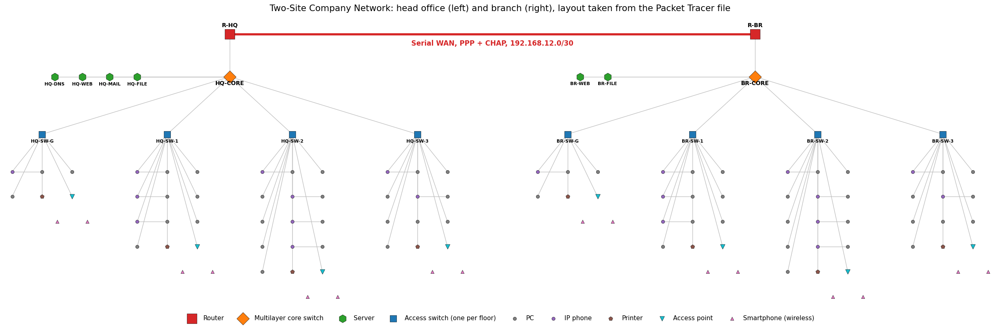

# Two-Site Company Network over a PPP/CHAP WAN

Complete two-site company network designed and configured in Cisco Packet Tracer. A head office and a branch, each a four-floor building, joined by a leased serial line running PPP with CHAP authentication. University coursework project (Computer Networks, Al Ryada University).

## What is built

- **124 devices** across two mirrored sites
- **WAN:** Cisco 2911 routers on a serial leased line - PPP encapsulation, CHAP authentication, clock rate 64000 on the DCE end, static routes between sites
- **Per site:** a Cisco 3650 multilayer core (inter-VLAN routing + DHCP) and one 2960 access switch per floor
- **14 VLANs per site:** 9 department VLANs plus management, servers, wireless, printers and voice (the third octet of each subnet equals the VLAN ID; all LAN subnets are /24)
- **IP telephony (configured):** CME on both routers, 20 Cisco 7960 phones on voice VLAN 200 (DHCP option 150), directory numbers 1001-1010 (HQ) and 2001-2010 (BR), VoIP dial peers routing cross-site calls over the WAN
- **Servers (VLAN 110):** DNS, Web, Mail and File roles configured at HQ; Web and File at the branch. DHCP hands every client the HQ DNS server across the WAN; DNS records and fictional lab mailboxes are saved in the project file, with two email clients configured for a cross-site demo. DNS resolution and email delivery still need verification in Packet Tracer.
- **Per floor:** department PCs, one IP phone per department office, a network printer, and an access point serving smartphones

## Addressing plan

| Item | Head Office | Branch |
|---|---|---|
| LANs | 10.10.0.0/16 | 10.20.0.0/16 |
| Serial WAN | 192.168.12.0/30 (R-HQ .1 DCE, R-BR .2) | - |
| Router-to-core transit | 10.10.255.0/30 | 10.20.255.0/30 |

One DHCP pool per VLAN on each site's core (.1-.9 excluded), voice pool with option 150 pointing at the router.

## Configuration covered in the report

PPP + CHAP on the serial link, static routing end to end, SVIs and DHCP pools on both cores, trunk and access port layout on every floor switch (data + voice VLANs), wireless, and the full CME telephony setup with dial peers.

## Status (honest)

- The .pkt file was machine-audited (0 problems) and every stored running-config was read back and verified - no configuration line known to be dropped on load is present.
- Scripted and ready to run: five ping scenarios covering local and cross-site connectivity, embedded in the file as clickable PDU scenarios.
- Configured but not yet run in the simulator: PPP/CHAP negotiation, DHCP leases, Wi-Fi association, phone registration and calls. The full manual test plan is section 5 of the report.
- Wi-Fi uses open authentication as a demo convenience; the report lists WPA2-PSK hardening as an optional step.

## Files

- `two-site-company-network.pkt` - the Packet Tracer topology (124 devices; give it a minute to settle after opening on a weak laptop)
- `two-site-company-network-report.pdf` - full report: idea, topology, addressing plan, configuration steps, test plan
- `two-site-company-network-study-guide.pdf` - detailed study guide walking through every device, cable and configuration choice

## Skills demonstrated

Network design, VLANs, inter-VLAN routing, DHCP, PPP/CHAP WAN, static routing, Cisco CME / VoIP, wireless, Cisco IOS.
